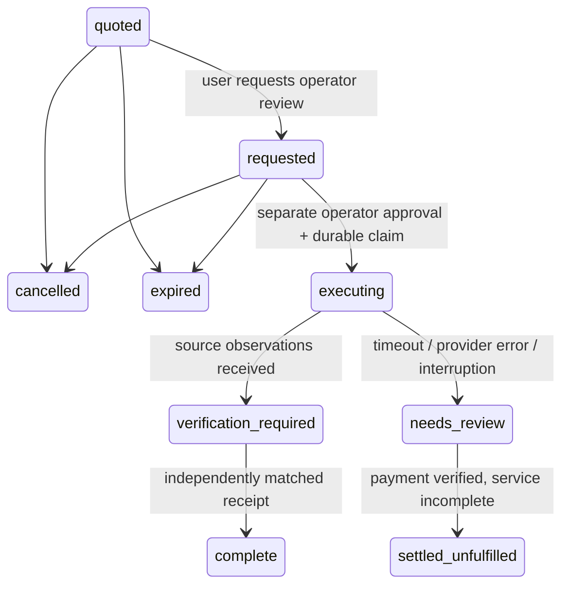

# OyaCheck mainnet pilot: implementation, release and approval plan

Current registration and buy blockers: [post-registration release candidate](POST-REGISTRATION-RELEASE.md).

Earlier update: [identity and read-only release candidate](IDENTITY-AND-RELEASE-RC.md)
records the issued event tag, current ERC-8004 procedure and stricter hosted
financial lockout. Production/Render purchase ledgers are now blocked by code;
this local pilot plan does not authorize enabling them.

Prepared 2026-11-07, on `fix/ai-reliability-mobile`. Deadline:
**November 9, 2026, 09:00 GMT**. This document is a plan, not spending approval.
No wallet was created, imported, registered, funded, unlocked or used to sign.
No paid service call, broadcast, deployment, push, merge or submission occurred.

## Current published contract

Checked the [official gateway skill](https://github.com/celo-org/buy-skill/blob/main/skills/use-api-gateway/SKILL.md),
[buy CLI docs](https://usebuy.ai/docs), and
[live catalog](https://gateway.usebuy.ai/v1/catalog).

- Browser capability: `browser.sessions.create`, provided by `buy-browser-worker`.
- Both networks use **the same** POST endpoint:
  `https://gateway.usebuy.ai/v1/browser/sessions`.
- Exact request body: `{"durationMinutes":1}`. There is no invented `/mainnet`
  or `/testnet` browser endpoint. Account/network and payment offer select chain.
- Mainnet is `celo`, chain ID **42220**. Sandbox is `celo-sepolia`, **11142220**;
  existing sandbox code still passes `--sandbox` and uses test USDC only.
- The genuine unpaid HTTP request returned 402, x402 v1, with a mainnet quote
  of **3606 atomic = 0.003606** in each supported token. This is a time-bound
  observation, not a promised future price.
- Mainnet recipient pinned in the adapter:
  `0x20faAca5F980E29639A0FCC6dcA6988E18ed333B`.

| Token | Mainnet asset, six decimals |
| --- | --- |
| USDC | `0xcebA9300f2b948710d2653dD7B07f33A8B32118C` |
| USDT | `0x48065fbBE25f71C9282ddf5e1cD6D6A887483D5e` |
| USAT | `0xD2ab3C9A02DBBAB236BfEC45D1d755DF4267F771` |

The captured **unpaid public contract**, not payment evidence, is in
`test/fixtures/buy-browser-contract.json`. Its agent ID belongs to the service
provider, not OyaCheck. Tests independently check these captured offers against
our adapter, rather than deriving every fixture from adapter constants.

A paid response supplies a secret rental token, session ID, readiness/expiry
and gateway status/command URLs. Commands use that token on backend stdin and
are not individually charged. Only documented open/get/snapshot/screenshot and
session cleanup are used. No script evaluation, arbitrary submitted URL, form
interaction or unsupported destination-interception API is assumed.

The pilot deliberately accepts only the current **v1 exact** offer. A protocol,
asset, recipient, schema or price change fails closed. CLI 0.8.5 is installed
and documented by buy; a different version needs verification. The CLI probes
again when buying: the quote is not an immutable upstream reservation. We
revalidate immediately before claiming and cap the CLI at the exact approved
price, token and named payer. The CLI does not expose a quote-reservation ID or
recipient-pinning flag. Gateway trust and the short quote-to-payment interval
remain assumptions; receipt validation detects a mismatched recipient after the
fact. Do not describe this as cryptographic binding to an upstream reservation.

## Implemented authority and durable state

New modules: `lib/mainnet-store.mjs`, `lib/mainnet-buy.mjs`,
`lib/mainnet-http.mjs`, `lib/mainnet-reconcile.mjs`.

- SQLite WAL, `synchronous=FULL`, busy timeout and `BEGIN IMMEDIATE` protect
  state transitions and spending reservations across cooperating local processes.
- A database transaction commits the attempt **before** invoking buy. Payer
  reservations survive process death and reload. Tests kill a process after claim.
- Hard ceilings: 10000 atomic (0.01 units of the selected token) per purchase;
  10000 atomic total per local user session per UTC day; **one lifetime payment
  attempt per payer across tokens/users**. A failed, uncertain or reconciled
  attempt never restores that allowance. Actual CLI maximum is the quoted price,
  not the larger hard ceiling.
- Quote expiry: 90 seconds. Quote ID, session owner, normalized investigated
  hostname, payer, account, token, asset, recipient, endpoint/body and maximum
  are retained with a SHA-256 plan fingerprint. Stable client request IDs are
  unique per session and cannot be reused for a different investigation.
- Browser principals are 256-bit opaque HttpOnly/SameSite=Strict cookies, stored
  hashed server-side. Mutations require same-origin requests and a session CSRF
  token. Purchase IDs alone grant no access. Client price/wallet/approval fields
  are rejected; plan data comes from server configuration and free provider data.
- Direct loopback IP **and** pinned localhost Host are required. Public/proxy
  requests are rejected. Sessions last 24 hours; they are not verified human or
  hackathon identities. Loss of the cookie requires operator-assisted recovery.
- Browser requests can only prepare, request review, cancel or read status.
  There is **no HTTP execute, operator-approve or reconcile route**. A request
  for operator review is not a financial authorization.
- Actual execution is an operator-only CLI command, requiring a matching fresh
  request fingerprint, named wallet verification, revalidated quote/balance and
  `OYACHECK_MAINNET_EXECUTE=1`. This flag remains off in repository deployment
  configuration and was never enabled against a real wallet.



No transition retries a purchase. An old executing record becomes `needs-review`
after two minutes when read, retaining its reserved allowance. A live process
can still finish observations; that does not create another financial request.

Reconciliation is read-only onchain: the fixed Celo RPC must report chain 42220,
a successful receipt, a block timestamp in the attempt window, and a Transfer
from the approved payer to the service recipient on the selected token contract,
with positive amount no greater than the approved quote. The recorded transaction
hash cannot be replaced. Missing/failed/mismatched receipts keep the allowance
reserved. This verifies an observed chain receipt, not a claim of finalized
settlement. It never retries, refunds or unlocks spending.

The ledger contains sanitized plans, public transaction references and public
source observations, not wallet keys, signatures, authorizations or session
access tokens. Database and WAL artifacts are gitignored. Directory/file modes
are private. Do not delete, reset or roll back the database to bypass the pilot.
Use a persistent local filesystem, single operator host and consistent backups;
network filesystems or independent replica disks are unsupported. Rollback of
application code must preserve the ledger. Protection does not extend to a
malicious administrator who can replace the database or use the wallet directly.

## What the user actually learns

The browser opens only the exact published NCC advisory. It records final URL,
page title, exact hostname mention, retained text snapshot (up to 128 KiB), an
excerpt from that snapshot, a reproducible SHA-256 digest and observation time.
Its result stays separate from the deterministic findings.

Receiving source observations yields `verification-required`, not a claim that
payment has been independently confirmed. A matching receipt produces `complete`;
a settled payment with no successful source result becomes `settled-unfulfilled`.
The UI retains these states and receipt links across reloads. It never calls the
submitted website safe or implies its content/forms/redirects were checked.

This narrow refresh gives observable published-source evidence. Arbitrary-site
inspection, safe pre-navigation redirect/DNS interception and a universal
phishing verdict remain unsupported. Final-URL checking occurs after navigation;
no stronger gateway redirect enforcement is assumed.

## Existing wallet requirements: no setup performed

Read-only `buy account list` showed only the existing sandbox account. The
registered hackathon payer, ERC-8004 identity, entry URL, mainnet funds and any
wallet elsewhere remain **unknown**, not absent.

An operator must identify an **existing** buy account on Celo mainnet, controlled
through its existing secure key store. No private key or seed should be pasted
into this project, browser, source tree or chat. Do not run setup/import or create
an identity without separate human approval.

Required non-secret operator configuration:

```text
OYACHECK_MAINNET_PREPARE=1
OYACHECK_MAINNET_EXECUTE=0
OYACHECK_PURCHASE_DB=/absolute/persistent/private/path/pilot.sqlite
OYACHECK_BUY_ACCOUNT=<existing-named-mainnet-account>
OYACHECK_BUY_PAYER=<that-account-public-address>
OYACHECK_BUY_TOKEN=USDC  # alternatively USDT or USAT
```

`buy --account NAME whoami` is a read-only metadata/balance check. The adapter
requires the displayed mainnet payer to match the configured public address,
and sufficient balance of the selected token. It never silently chooses a
second/default wallet. Buy's x402 settlement sponsor normally supplies gas;
funding the wrong chain or a different stablecoin does not satisfy the selected
quote. A USAT-only wallet must select USAT explicitly. No funding is authorized
by this plan. The existing sandbox balance is not mainnet money.

## Read-only repository and production audit

- Public repository confirmed: `https://github.com/Alike001/oyacheck`.
- Live `git ls-remote` / GitHub branch data: remote main at
  `41b04233a8430975d498d5ab502596700449ab0e`; deployment branch
  `chore/public-beta-deployment` at
  `638e61fff3256a8dce74b6937dddc9a888559c8c`.
- Before this new commit, local HEAD `2d5326b` was 5 commits ahead/0 behind main,
  and 2 ahead/0 behind the deployment branch. The new commit adds one to each.
  The current feature branch was not present on the remote. No fetch/push/merge
  or branch changes were necessary for the audit.
- User-confirmed Alike Render workspace: `oyacheck-beta`, free Node service in
  Frankfurt, one instance, auto-deploy **off**; build
  `npm ci --include=dev && npm run check && npm test`, start `npm start`,
  health path `/api/health`.
- Current live deploy `dep-dbng9is9v7es73cmsig0`, commit `638e61f`. Public health
  returned 200, v0.10.0, Groq configured, sandbox inspection/demo disabled. It
  predates all local fixes and does not advertise mainnet preparation.
- Repository `render.yaml` now explicitly keeps both mainnet flags **0**, along
  with the existing sandbox/demo flags. No production setting was changed.
- Node minimum is 22.13 (built-in SQLite without its opt-in flag), bounded below
  Node 25. `.node-version` pins tested Node **24.14.1**. Its SQLite API currently
  emits an experimental warning; core operations used here are verified locally.
  Check any dashboard `NODE_VERSION` override before release: it takes precedence
  over the file. Runtime secret values were neither requested nor revealed.
- Entry registration/agent wallet/ERC-8004/independent-user evidence remains
  unknown. The provider identity in the catalog is not OyaCheck's identity.
  The [organizer FAQ](https://www.loops.house/agents-on-open-rails) distinguishes
  the buy track's no-tag purchase rule from attribution on other transactions.

## Exact production release sequence (not executed)

1. Review the local commit and its tests. Obtain separate permission to push the
   existing feature branch and open a PR into `chore/public-beta-deployment`.
   Keep auto-deploy off. Review/merge only after separately authorized.
2. For the **read-only beta**, retain every financial/demo flag at 0. Confirm
   runtime pin/override, build/start/health settings and choose the exact reviewed
   commit SHA. Do not install or configure a production wallet just for this deploy.
3. Obtain deployment approval for that exact commit, then manually deploy it.
   Check Render's live commit/status and HTTP health. Verify `/api/mainnet/session`,
   sandbox quote and demo routes return 403; run known/unknown link checks and
   confirm no submitted URL is visited. Genuine Groq checks remain separately
   bounded/approved; key presence alone does not prove quota or response quality.
4. Keep the mainnet pilot on an **isolated operator host**, not the public free
   service. Provision a durable private ledger path and identify the existing
   named mainnet wallet only after human direction. Leave execution at 0. No
   paid Render plan, disk, wallet creation or funding is authorized here.
5. Run the free preparation flow locally, inspect its plan with `--show`, then
   request the exact financial approval below. Public multi-user spending is
   blocked pending real authentication, persistent-host operations, service-level
   validation and explicit release approval. A free ephemeral filesystem is
   insufficient for this financial ledger.
6. After a genuine single-purchase result, reconcile independently, preserve
   sanitized evidence and evaluate the pilot. Do not expand spending or reset
   the one-attempt allowance without a separately reviewed implementation.

## Isolated single-purchase test and exact approval

Before asking to spend, populate **all** of the following from a fresh server
plan. A mainnet wallet and corresponding entry/identity evidence have not yet
been supplied, so there is no spend-ready approval request in this session.

| Field | Required review value |
| --- | --- |
| Service | `browser.sessions.create`, `buy-browser-worker`, one minute |
| Request | POST `https://gateway.usebuy.ai/v1/browser/sessions`, body `{"durationMinutes":1}` |
| Investigation | Examined NCC-listed hostname and exact published advisory URL |
| Chain | Celo mainnet, 42220; never Sepolia evidence presented as mainnet |
| Account / payer | Actual existing named account and its verified public address; currently unknown |
| Token / asset | Exactly one of the three contracts above, with sufficient mainnet balance |
| Fresh quote / CLI maximum | Current server quote; observed today: 0.003606, not a standing price |
| Recipient | `0x20faAca5F980E29639A0FCC6dcA6988E18ed333B` |
| Purchase ID / fingerprint / expiry | Exact fresh values shown by server; never mock fixture values |
| Spending scope | One attempt, exact quoted maximum; no retry or additional service purchases |

The human financial approval must explicitly state:

> Approve one `browser.sessions.create` one-minute purchase on Celo mainnet
> (42220) for purchase **[ID]**, fingerprint **[FINGERPRINT]**, from existing
> account **[NAME]**, payer **[ADDRESS]**, paying at most **[FRESH PRICE] [TOKEN]**
> on contract **[ASSET]** to **[RECIPIENT]**. Inspect only **[EXACT NCC ADVISORY]**.
> No automatic retry, second purchase or unrelated transaction is authorized.

If that human approval arrives and the quote is still valid, the operator-only
command is:

```text
OYACHECK_MAINNET_EXECUTE=1 node scripts/mainnet-pilot.mjs --execute ID --approve FINGERPRINT
```

Do **not** run it during preparation. An expired or changed plan needs new review;
a client-supplied `approved: true` cannot substitute for operator authority.

Expected evidence: actual named payer, exact service/request, approved quote,
provider result and observation time, retained public text snapshot/hash/excerpt,
actual settled amount, Celo mainnet transaction hash and explorer URL, source
limitations, and any failure/correlation records safe to disclose. No wallet
secrets, raw signatures, session credentials or paid authorizations belong in
submission evidence. To reconcile without spending:

```text
node scripts/mainnet-pilot.mjs --show ID
node scripts/mainnet-pilot.mjs --reconcile ID
```

If the hash is missing after an interruption, inspect the original named buy
account's receipts without purchasing again. A separately reviewed
`--transaction HASH` can supply that recovered public hash to reconciliation;
chain, time, token, payer, recipient and amount must still match. A missing or
failed receipt never grants permission to retry. The UI cannot reconcile itself.

## Verification and remaining blockers

- `npm run check`: exit 0.
- Full suite: **235 total, 232 passed, 3 skipped, 0 failed** (final run recorded
  after all implementation changes).
- Mainnet regression file: **30 passed**, including real SQLite reopen/locking,
  killed-process reservation, cross-user/CSRF/Host guards, request forgery,
  idempotency, expiry, ceiling/replay controls, matching/mismatched receipts,
  captured live contract validation and fake CLI wallet/maximum checks.
- `OYACHECK_RUN_LIVE_DEMO=1 npm run demo:live`: 3 passed, 0 skipped, 0 failed.
  These are the default suite's same three opt-in skips, using real Chrome and
  controlled synthetic pages rather than external service purchases.
- Real Chromium ran `scripts/verify-mainnet-browser.mjs` against two fresh
  financial-fake fixtures: unavailable provider, insufficient funds, cancellation,
  expiry, user request, source-observation success, partial payment outcome and
  recovery across reloads all passed. One mock financial call per outcome,
  **zero real financial calls**, no retries and unchanged deterministic verdicts.
- Both populated outcome views fit 320/360/390/412/768 CSS-pixel widths without
  horizontal document overflow. Physical mobile keyboard/microphone acceptance
  remains outside these headless tests.
- `git diff --check` and added-script syntax checks passed. All actual external
  activity was free documentation/catalog/402/read-only account/production audit.
  No genuine Groq completion, wallet creation or paid request occurred.

Remaining blockers: actual mainnet account/payer/funds are not configured;
entry/ERC-8004/independent-user evidence is unknown; separate financial approval
has not been given; no genuine paid mainnet result or provider success under this
new adapter is verified. Public authenticated spending and multi-host operation
are not implemented. Production remains on its older commit by instruction.
